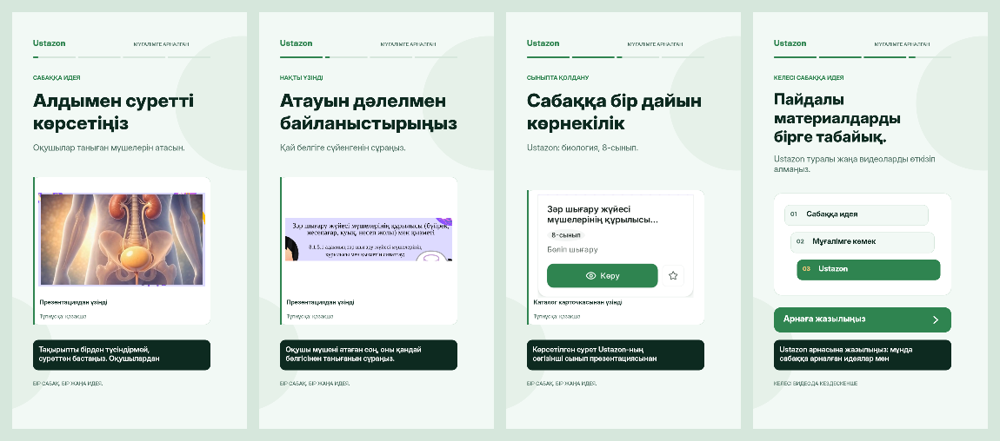
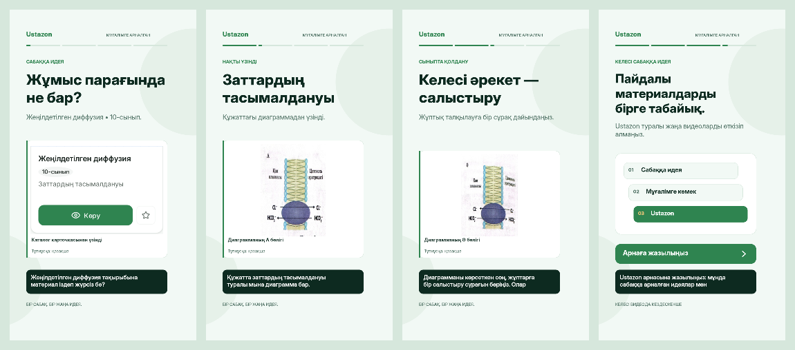

# Dara Teacher · Ustazon Shorts

Ustazon материалдарын қазақша және орысша YouTube Shorts видеоларына айналдыратын бот.

- Нақты екі материалдан 12 сценарий, екі тілде 24 нұсқа.
- Презентация слайдтары, жұмыс парағының диаграммасы және каталог карточкалары кадрда көрсетіледі.
- 1080×1920, Gemini дыбысы, субтитрлер, күніне 2 қазақша + 1 орысша слот.
- Қайталанған роликтерді тежеу, үзілістен кейін жалғастыру және тегін API лимитін сақтау.
- GitHub Actions үшін шифрланған тұрақты күй мен бөлек CI тексерісі.

## Қарап көру

## Іске қосу

Node.js 24+:

~~~sh
npm ci --prefix ustazon
npm run test:ustazon
npm run video:check
npm run video:budget
npm run video:daily
~~~

.env.gemini.example файлын .env.local ретінде көшіріп, Gemini кілтін жергілікті файлда толтырыңыз.

**[Толық орнату, Actions Secrets және YouTube қосу нұсқаулығы →](ustazon/README.md)**

Автожариялау бастапқыда өшірулі. Кодты жүктеу өздігінен Gemini кілтін не YouTube арнасын қоспайды. Қазіргі қор біткенде бот жаңа материал күтеді; шексіз бірдей видео шығармайды.

## Тексерілгені

60 автоматты тест және екі тілдегі барлық 24 кадр макеті жергілікті тексерістен өтті. Екі материал бойынша қазақша дыбысталған үлгілер жасалды. Жаңа орысша роликтің нақты TTS генерациясы байланыс қатесінен кейін әлі аяқталмаған; оның сценарийі мен макеті тексерілді. YouTube-ке нақты сынақ жүктеуі әлі жасалмады.

## Файлдар

- ustazon/stories.json — екі тілдегі тексерілген сценарийлер.
- ustazon/assets/materials/ — дереккөзі мен checksum-ы бар нақты кескіндер.
- ustazon/automation.json — кесте, лимиттер және жариялау баптаулары.
- .github/workflows/ustazon-checks.yml — код пен макеттерді тексеру.
- .github/workflows/ustazon-shorts.yml — генерация және жоспарлы жариялау.

Субтитрлер дыбыс ұзақтығына қарай жуық синхрондалады. Диктордың айтылуын және аудиторияға әсерін алғашқы жарияланымдарда қарап, тыңдап тексеру қажет.
